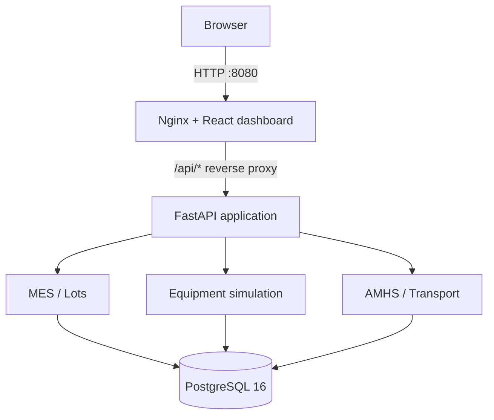

# SmartFab — Semiconductor MES & AMHS Simulator

A full-stack semiconductor manufacturing operations simulator that models wafer-lot tracking, process routing, equipment execution, and automated material handling (AMHS). SmartFab demonstrates how manufacturing workflows can be coordinated through REST APIs, a relational database, and a web dashboard.

> **Scope:** This is a portfolio and learning simulator. It does not control real semiconductor equipment, robots, or factory hardware.

## Features

- **Manufacturing Execution System (MES):** Create and inspect wafer lots, retrieve the next processing step, and track progress through a four-step manufacturing route.
- **Equipment simulation:** Monitor deposition, lithography, etching, and inspection tools; start and complete processing; simulate failures and recovery.
- **Automated Material Handling System (AMHS):** Track wafer carriers, stations, and transport-job lifecycles from queued to in transit to delivered.
- **Operations dashboard:** Display lot counts, wafer totals, equipment status, carriers, and transport jobs using React and TypeScript.
- **Data integrity:** Store manufacturing entities in PostgreSQL using SQLAlchemy relationships and constraints; reject invalid workflow transitions.
- **Automated quality checks:** Run 18 backend tests with Pytest and an isolated PostgreSQL test database; use GitHub Actions for backend testing, frontend linting, and production builds.
- **Containerized stack:** Run PostgreSQL, FastAPI, and the Nginx-served React frontend together through Docker Compose.

## Architecture



**Docker services and host ports:**

| Service | Responsibility | Local access |
| --- | --- | --- |
| `frontend` | Nginx serving the production React app and proxying `/api/*` | `http://localhost:8080` |
| `backend` | FastAPI REST API and manufacturing business logic | `http://localhost:8001` |
| `postgres` | Persistent PostgreSQL 16 database | `127.0.0.1:5433` |

Docker containers communicate through service names (`backend:8000` and `postgres:5432`). The host ports above are bound to localhost for local development.

## Technology Stack

| Layer | Technologies |
| --- | --- |
| Frontend | React 19, TypeScript, Vite, CSS |
| Backend | Python 3.13, FastAPI, SQLAlchemy, Psycopg |
| Database | PostgreSQL 16 |
| Runtime and packaging | Docker, Docker Compose, Nginx, Node.js 24 |
| Testing and CI | Pytest, FastAPI TestClient, HTTPX, GitHub Actions, ESLint |

## Manufacturing Workflows

### MES — wafer processing

The `STANDARD-4` route consists of four ordered manufacturing steps:

1. **Deposition** — index `0`
2. **Lithography** — index `1`
3. **Etching** — index `2`
4. **Inspection** — index `3`

After the final step, the lot reaches `COMPLETED` with step index `4`. The backend provides lot creation, next-step lookup, state transitions, and processing through equipment completion.

### Equipment — processing and failures

Four simulated tools are seeded: `DEP-01`, `LITHO-01`, `ETCH-01`, and `INSP-01`. Equipment operations include starting and completing work, reporting a machine as down, and recovering it. Workflow checks prevent incompatible state transitions; an interrupted lot is not silently advanced.

### AMHS — carrier movement

AMHS models carriers and transport jobs, with job states including `QUEUED`, `IN_TRANSIT`, and `DELIVERED`. Carrier availability and station location are updated as transport jobs progress. The simulation does not send commands to real material-handling hardware.

## Quick Start — Docker Compose

### Prerequisites

- Docker Desktop with Docker Compose
- Git

### 1. Clone the repository

```bash
git clone https://github.com/akshayagavhane9/smartfab-semiconductor-simulator.git
cd smartfab-semiconductor-simulator
```

### 2. Configure the database environment

```bash
cp .env.example .env
```

Open `.env` and change `POSTGRES_PASSWORD` to your own local password. Do not commit `.env`.

### 3. Build and start the services

```bash
docker compose up -d --build
docker compose ps
```

### 4. Initialize a new, empty database

The first time you start with a fresh PostgreSQL volume, create the tables and seed the reference data in this order:

```bash
docker compose exec backend python -m app.db.init_db
docker compose exec backend python -m app.db.seed_route
docker compose exec backend python -m app.db.seed_equipment
docker compose exec backend python -m app.db.seed_lot
docker compose exec backend python -m app.db.seed_carrier
```

The seed scripts check for existing route, equipment, lot, and carrier IDs, making repeated initialization less likely to create duplicate reference records. `seed_carrier.py` specifically expects sample lot `LOT-101`, so the lot must be seeded first. These commands seed starter data; they do **not** recreate every record shown in the project's development screenshots.

> **Setup verification pending:** `seed_lot.py` omits an explicit `route_id`. Before declaring this procedure validated from a completely empty database, confirm that `WaferLot` assigns the `STANDARD-4` route by default, or update the seed script to assign it explicitly.

### 5. Open SmartFab

| Interface | URL |
| --- | --- |
| React dashboard | [http://localhost:8080](http://localhost:8080) |
| FastAPI interactive Swagger documentation | [http://localhost:8001/docs](http://localhost:8001/docs) |
| Health check | [http://localhost:8001/health](http://localhost:8001/health) |

Check the backend and the frontend-to-backend proxy:

```bash
curl http://127.0.0.1:8001/health
curl http://127.0.0.1:8080/api/lots
```

### Stop the application

```bash
docker compose down
```

This stops the containers while retaining the named PostgreSQL volume. **Do not run `docker compose down -v`** unless you intentionally want to delete the stored manufacturing data.

## REST API

SmartFab includes MES, equipment, and AMHS API routers. Representative endpoints include:

| Method | Endpoint | Purpose |
| --- | --- | --- |
| `GET` | `/health` | Check API availability |
| `GET` | `/lots` | List wafer lots |
| `POST` | `/lots` | Create a wafer lot |
| `GET` | `/lots/{lot_id}` | Get one wafer lot |
| `GET` | `/lots/{lot_id}/next-step` | Identify the next processing step |
| `POST` | `/lots/{lot_id}/advance` | Advance a lot through its route |
| `GET` | `/equipment` | List equipment and current states |
| `GET` | `/amhs/carriers` | List wafer carriers |
| `GET` | `/amhs/jobs` | List transport jobs |

The equipment router also exposes operations to **start**, **complete**, **fail**, and **recover** equipment. The AMHS router exposes operations to **create**, **start**, and **deliver** transport jobs. For the exact request paths and schemas, use the interactive OpenAPI documentation at `/docs` rather than guessing request bodies.

When using the dashboard origin, prefix API paths with `/api` (for example, `/api/lots`). Nginx forwards these to the FastAPI service.

## Local Development

The containerized stack is the simplest way to run the full project. For local source development, first start PostgreSQL using Docker Compose:

```bash
docker compose up -d postgres
```

### FastAPI backend

From the repository root:

```bash
python3.13 -m venv backend/.venv
source backend/.venv/bin/activate
python -m pip install -r backend/requirements.txt
cd backend
uvicorn app.main:app --reload --host 127.0.0.1 --port 8000
```

The backend reads database credentials from the root `.env` file. For the local development server, PostgreSQL defaults to `127.0.0.1:5433`; Docker Compose overrides the host and port for the containerized backend.

### React frontend

In a second terminal, from the repository root:

```bash
cd frontend
npm ci
npm run dev
```

Use **Node.js 24** (the repository includes an `.nvmrc` file). Vite forwards development `/api/*` requests to `http://127.0.0.1:8000`. Check the terminal output for the local Vite URL.

## Automated Tests

The backend test suite contains **18 tests** covering API health, MES lot creation and routing, AMHS transport behavior, equipment transitions, and failure conditions.

Tests use a **dedicated PostgreSQL database** named `smartfab_test_db`, separate from the development database `smartfab_db`. The test fixtures use transactions/savepoints to roll back individual test changes.

For the first local test run, create the test database if it does not already exist:

```bash
docker compose up -d postgres
docker compose exec postgres sh -c 'psql -U "$POSTGRES_USER" -d postgres -c "CREATE DATABASE smartfab_test_db;"'
```

Then, with the backend virtual environment activated and dependencies installed:

```bash
cd backend
python -m pytest -v tests/
```

If the test database already exists, skip the `CREATE DATABASE` command. The test suite should not be run against your regular manufacturing database.

For frontend validation:

```bash
cd frontend
npm ci
npm run lint
npm run build
```

## Continuous Integration

The GitHub Actions workflow at `.github/workflows/ci.yml` runs on pushes and pull requests targeting `main`.

- **Backend job:** Starts PostgreSQL 16, creates `smartfab_test_db`, installs Python 3.13 dependencies, and runs Pytest.
- **Frontend job:** Installs Node.js 24 dependencies, runs ESLint, and builds the production React bundle.

Both jobs successfully passed in the initial CI run for commit `3e3b3ca`. CI performs automated checks; it does not deploy SmartFab to an external hosting service.

## Project Structure

```text
smartfab-semiconductor-simulator/
├── .github/workflows/ci.yml
├── .env.example
├── docker-compose.yml
├── backend/
│   ├── Dockerfile
│   ├── requirements.txt
│   ├── app/
│   │   ├── api/           # MES, AMHS, equipment endpoints
│   │   ├── db/            # Connection, sessions, initialization, seeders
│   │   ├── models/        # SQLAlchemy manufacturing models
│   │   └── main.py
│   └── tests/              # Pytest integration tests
└── frontend/
    ├── Dockerfile
    ├── nginx.conf
    ├── package.json
    └── src/                # React dashboard
```

## Future Enhancements

The following items are **planned improvements**, not features of the current implementation:

- **Real-time factory dashboard:** Use WebSockets or Server-Sent Events to update wafer-lot, equipment, and transport states without manually refreshing the page.
- **Intelligent lot dispatching:** Add priority-based scheduling, equipment eligibility checks, and work-in-progress (WIP) queue optimization to simulate factory bottleneck management.
- **Advanced AMHS routing:** Simulate multiple carriers, station-to-station routing, travel times, transport delays, and competing material-movement requests.
- **Equipment performance and predictive maintenance:** Track utilization, processing time, downtime, and failure trends; explore anomaly detection and maintenance alerts using simulated operational data.
- **Configurable manufacturing scenarios:** Support additional process routes, lot holds/rework, equipment failures, and repeatable scenarios for comparing throughput and cycle time.
- **Operational analytics:** Add historical charts and KPIs for WIP, throughput, cycle time, equipment availability, and transport efficiency.
- **Production-readiness improvements:** Introduce role-based access control, database migrations, structured audit logs, monitoring, and stronger concurrency protections; explore cloud deployment and Kubernetes orchestration.

## Scope and Limitations

- SmartFab is a **software-only manufacturing simulator**. It does not control physical semiconductor equipment, robots, or factory hardware.
- The current React dashboard primarily displays manufacturing state; operational transitions are performed through REST APIs.
- The project demonstrates manufacturing concepts and application architecture; it is not intended to serve as a production-grade MES or AMHS platform.
